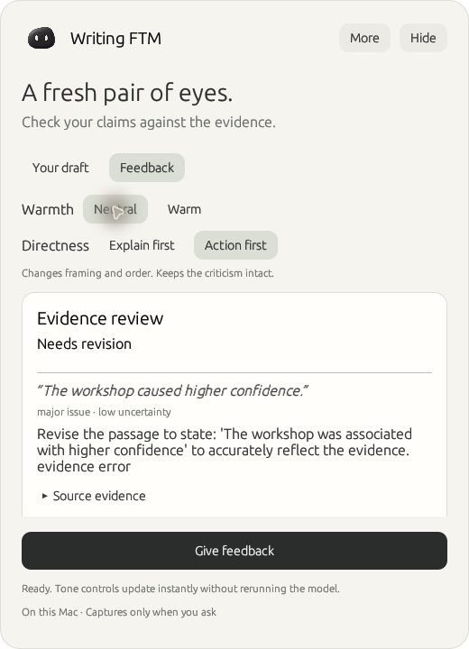
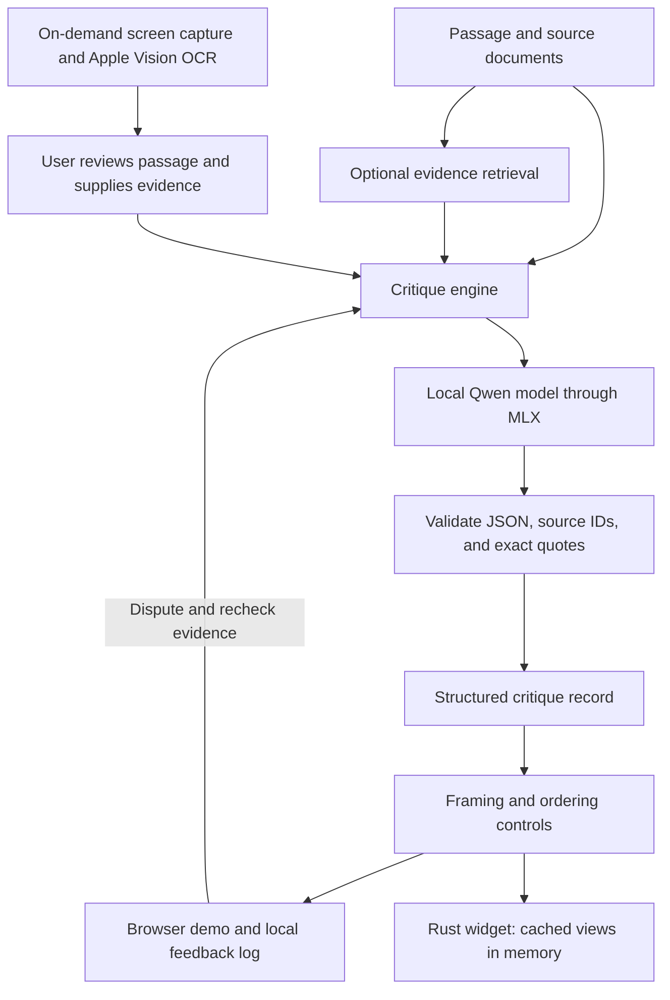

# Writing-FTM

A local macOS writing-critique assistant and research prototype. A Rust companion captures text on demand, runs an evidence-based critique through a local model, and lets you adjust presentation without rewriting the criticism.



**v0.1.0 · Research prototype · Apple Silicon for live inference.** [Visual walkthrough](docs/demo.md) · [Release checks](docs/release-v0.1.0.md) · [Model-free demo](#try-it)

## Motivation

The project started with a practical idea: fine-tune a model on a Mac to help with academic writing and learn from ongoing feedback. Calibrating example responses revealed a more interesting problem. A response could feel warmer but still be less useful, less direct, or harder to read. Warmth and preference were not interchangeable.

That led to the current research question: **when someone asks an AI to make its feedback warmer or more natural, how can it preserve the criticism that is actually justified?** The reverse matters too: if the original criticism is wrong, the system should reconsider it rather than preserve the mistake.

Writing-FTM investigates this through a small, inspectable system: local model inference, structured critiques, evidence retrieval, user feedback, and reproducible evaluation. The broader aim is to study the tension between personalization and reliable feedback. The current implementation establishes a baseline for that work.

## What it does

Given a passage and source material, the engine produces a `retain` or `revise` verdict with a rationale. Each issue records the relevant passage, source evidence, severity, uncertainty, and a recommended correction.

The local demo lets you inspect that record, change the framing and order of feedback, save preferences, and dispute a diagnosis. A dispute sends the evidence back through the model for reassessment. The CLI also supports a lexical retrieval baseline that selects evidence documents from a supplied collection.

Today, tone controls use fixed framing and field ordering. They preserve the stored diagnosis and advice exactly; they do not perform free-form rewriting. The browser demo logs feedback locally for later review; the widget keeps its session in memory and does not yet collect ratings or expose disputes. Neither trains the model automatically. A [20-update neutral-feedback QLoRA pilot](research/results/finetuning-pilot-v1/REPORT.md) has now run. It lowered validation loss but left verdict accuracy at 7/8 and introduced one repetitive, truncated response. A [follow-up repair](research/results/repetition-repair/REPORT.md) removed the observed repetition across two seeds using the official chat template and a lower learning rate. Verdict accuracy remained 7/8. The adapters are experimental and are not used by the demo.

## Simple architecture



The Python engine is shared by the CLI, browser demo, Rust widget worker, and benchmark runner. Validation rejects malformed records and quotes absent from the supplied text. It does **not** establish that the evidence supports the model's reasoning. [Architecture and design decisions](research/architecture.md).

## What the experiments found

The original model approved a causal claim supported only by an observational association. It treated a plausible inference as sufficient evidence. An explicit evidence-support rule corrected that example, but the improvement did not generalize reliably.

| Evaluation | Correct verdicts |
|---|---:|
| Development, previous prompt | 8/10 |
| Same development inputs, explicit evidence rule | 10/10 |
| Reserved passages, frozen revised prompt | 4/8 |

Development covered five source groups; reserved evaluation covered four. Invalid outputs count as failures. Some correct verdicts still contained invented details in their explanations. The [case study](research/results/diagnosis-study.md) includes full outputs, failure analysis, manifests, and reproduction details.

## Background companion (Rust)

The Rust app provides a floating macOS companion. Clicking it opens an overlay with on-demand screen capture, local OCR, editable passages and source evidence, and structured critiques from the local model. Warmth and directness controls adjust framing and order while preserving the diagnosis and citations. It does not continuously watch the screen.

```sh
./scripts/setup_local.sh
./scripts/build_widget.sh
open "runs/widget/Writing FTM.app"
```

Building the widget also requires Rust/Cargo, Xcode command-line tools, and a signing identity; the widget guide documents the temporary ad-hoc option. This source release is not a notarized app download. Grant Screen Recording access when prompted, or paste text without screen access. The interface and capture/OCR integration are Rust; the existing Python/MLX engine provides inference. See the [widget guide](widget/README.md) for setup, controls, and privacy behavior.

## Try it

For a model-free demo, use Python 3.12+ from the repository root:

```sh
python3 -m unittest discover -s tests -v
python3 -m writing_ftm.demo
```

Open http://127.0.0.1:8765. Fixture mode replays a labeled example and refuses edited inputs. No third-party dependencies are required. Stop with Ctrl-C.

For live inference on Apple Silicon:

```sh
./scripts/setup_local.sh
.venv/bin/python -m writing_ftm.demo --live
```

Setup requires [uv](https://docs.astral.sh/uv/getting-started/installation/). It creates `runs/runtime/model.json` for a pinned 4-bit Qwen3-4B snapshot with the audited Instruct template. Run `.venv/bin/python -m scripts.check_setup` to diagnose missing files. Setup is repeatable; `./scripts/setup_local.sh --offline` reuses a cached snapshot. The CLI, browser demo, and widget use this same default configuration; inference never downloads a model. It runs locally without a paid API. The measured machine is an M3 Pro with 18 GB unified memory; see the [capacity measurements](research/results/mac-capacity.md). The demo is a single-user local server. See the [walkthrough](research/demo-guide.md) for live disputes and feedback logging.

CLI with optional retrieval:

```sh
.venv/bin/python -m writing_ftm --input examples/critique-request.json --retrieve-k 1 --output runs/my-critique.json
```

Reproduce the evaluations with new output directories:

```sh
.venv/bin/python -m scripts.benchmark_critique --output runs/my-development
.venv/bin/python -m scripts.benchmark_critique --dataset examples/diagnosis-heldout.json --arms evidence_standard --split heldout --output runs/my-heldout
python3 -m scripts.benchmark_retrieval
```

## Limitations

- **Diagnosis remains unreliable.** Exact citations and valid JSON can accompany incorrect reasoning. Human review is required.
- **The benchmark is small and synthetic.** Sources and labels are AI-authored; neither the labels nor the findings have independent human validation. Repeated passages from a source are dependent observations.
- **Tone control is constrained.** Perceived warmth and preference improvements have not been established. Generative rewriting and style-example retrieval are not implemented.
- **Retrieval evidence is limited.** The baseline was measured on six documents, not a realistic research corpus.
- **This is an AI-assisted research prototype.** It is not an autonomous grader or a production service. The reserved sources have now been evaluated and must not become a reusable claim of unseen performance.

Private writing references, ratings, models, and runtime logs are excluded from Git. The committed benchmark contains newly authored fictional passages. [Dataset provenance](data/writing-v1/DATASET_CARD.md).

## Ways forward

1. **Improve the evaluation foundation.** Obtain independent human review, clarify ambiguous task definitions, and build new held-out source groups before further tuning.
2. **Test diagnosis beyond the final verdict.** Evaluate claim coverage, evidence support, invented details, and whether the model corrects mistaken critiques when challenged.
3. **Study repeated tone changes.** Compare ordinary rewriting, two-stage personalization, and critique-checked rewriting. Measure criticism retention, readability, warmth, and preference separately.
4. **Explore retrieval and training where justified.** Add reviewed style examples and harder retrieval cases. Consider supervised or preference-based fine-tuning after reliable labels and baseline failures establish a reason to train.

Tone controls and two-stage personalization have close prior work. Any novel contribution remains to be demonstrated. See the [research roadmap](research/HANDOFF.md) and [retrospective](research/retrospective.md).
