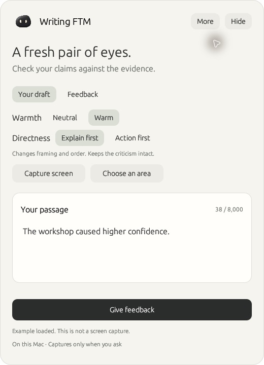
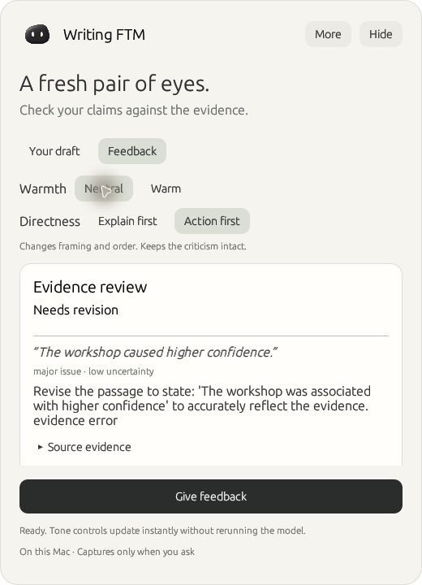
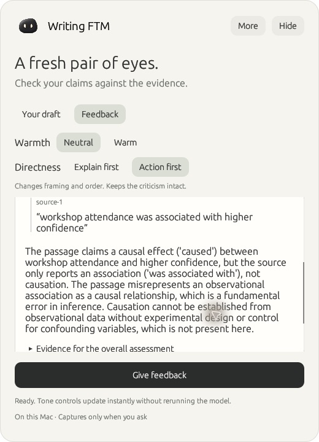
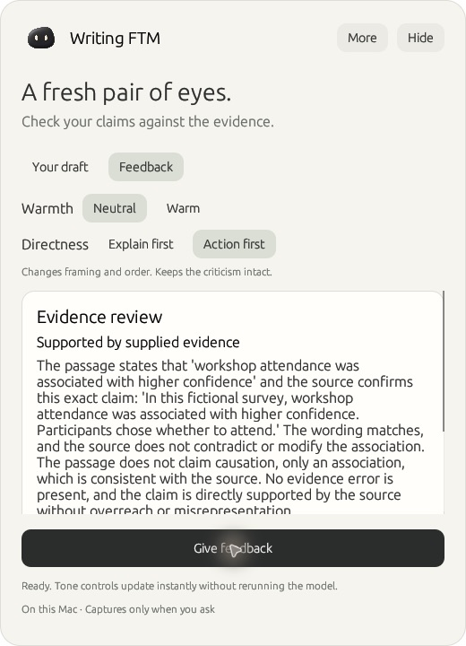

# Visual walkthrough

Actual Writing-FTM app captures using fictional demonstration text. These are selected steps, not a recording of inference latency. The desktop model is the pinned base model; experimental QLoRA adapters are not loaded.

1. Click the floating companion to expand the overlay. Paste a passage and a separate source excerpt, or use **More → Try an example**.
2. Click **Give feedback**. The example claims that a workshop caused higher confidence; its source describes a self-selected observational survey. The model identifies the unsupported causal inference.
3. Switch **Warm / Neutral** and **Explain first / Action first**. Only framing and ordering change. The diagnosis, recommended correction, evidence, severity, and uncertainty remain intact.
4. Expand **Source evidence** to inspect the exact quotation. A matching quotation does not prove that the diagnosis is correct.
5. Edit the passage to “Workshop attendance was associated with higher confidence.” Previous feedback clears. A new assessment accepts this qualified association.

## Passage and evidence

## Correction first

## Exact source quotation

## Qualified claim

[Run the model-free browser demo](../README.md#try-it) · [Release checks and limitations](release-v0.1.0.md) · [Why the training adapter repeated itself](../research/results/repetition-repair/REPORT.md)
