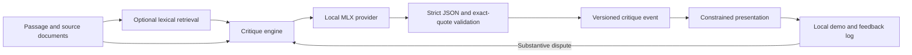

# Architecture and design decisions

Writing-FTM is a local, single-user research prototype. Python components are shared by the CLI, benchmark runner, and browser demo.

## Decisions

- **Evidence standard before model size.** The original prompt allowed plausible unsupported inferences. A controlled prompt ablation directly tests that failure without new model downloads or training. Correct verdicts still do not establish complete or factual explanations.
- **Separate diagnosis from delivery.** Fixed framing and field ordering preserve the stored diagnosis, recommendation, severity, and uncertainty. They offer less flexibility than generative rewriting. This baseline does not validate perceived warmth or solve the proposed repeated-rewrite research question.
- **Explicit provenance.** Quotes must occur uniquely in the supplied passage/source. Unknown IDs, ambiguous quotes, invalid JSON, inconsistent verdicts, and truncation fail closed. Exact matching can reject valid paraphrases; it cannot prove entailment.
- **Measured retrieval baseline.** A deterministic lexical ranker returns source IDs, texts, and scores. The CLI supports `--retrieve-k`; the browser demo supplies a single source directly. Evidence retrieval is implemented; style-example retrieval is deferred until examples have adequate human review. No held-out feedback targets are indexed.
- **Local execution.** One MLX provider serializes inference. The demo binds to loopback, restricts Host headers, and requires a session token for writes. It is not a multi-user production server. User text and review events remain under ignored `runs/`.

## Failure handling and provenance

The CLI uses exclusive creation for events. Evaluator reruns merge annotations and reject changed review inputs. Run manifests record model revision, engine hash, input hash, and decoding settings. Benchmark errors count as incorrect rather than disappearing from accuracy. The demo retains the last successful assessment if a new request fails; an error message is shown. Its fixture mode clearly labels replayed responses and refuses edited inputs or disputes.

No automated semantic guarantee is made. Human evidence review, multi-user isolation, robust prompt-injection evaluation, and large-corpus retrieval are outside this release.
